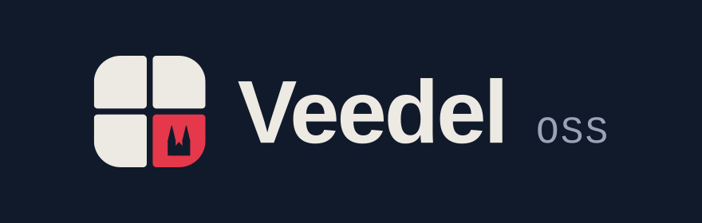

<picture>
    <source srcset="../assets/veedel-oss-banner.svg" type="image/svg+xml">
    
</picture>

# Veedel OSS

Small, sharp open-source tools for SysAdmins, DevOps, DevSecOps teams who look after Linux server landscapes.

*Veedel* is Cologne dialect for "neighbourhood", and that is the idea: know your neighbourhood of machines, see what is going on, and never touch more than you have to.

## Principles
* **Look, don't touch.** Our tools make state visible and leave the decisions to you.
* **Least privilege.** Anything that needs root stays minimal and auditable.
* **Few dependencies.** Easy to install on the systems you actually run.
